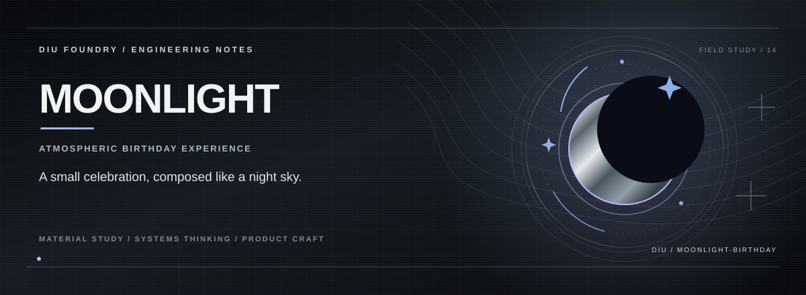

# Moonlight Birthday

An interactive, moonlit birthday web experiment focused on atmosphere, motion, typography and a memorable single-page experience.

## Focus

- Immersive visual presentation
- Responsive layout
- Interactive frontend effects
- Lightweight creative web experience

## Requirements

Node.js 20+ and pnpm.

## Run the frontend

From the repository root, install the workspace dependencies:

```bash
pnpm install
```

Start the Vite frontend:

```bash
cd src/frontend
pnpm dev
```

Vite prints the local development URL in the terminal.

## Quality checks

Run the workspace build, type-check and formatting/lint checks from the repository root:

```bash
pnpm run build
pnpm run typecheck
pnpm run check
```

Use `pnpm run fix` to apply the configured Biome fixes. The root package does not define a `dev` script; the frontend is started from `src/frontend`.

## Status

**Creative web experiment**. This is a frontend experience, not a production birthday-event platform.

## Author

**K. Kishor Kumar** · [GitHub @Kishordiu](https://github.com/Kishordiu)
